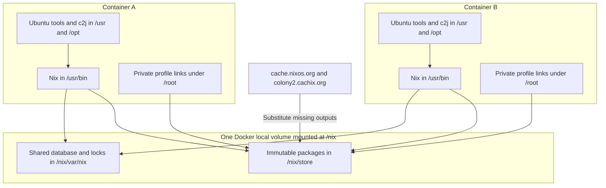

# Proposal: Ubuntu tooling with a shared live Nix store

Status: implemented, 2026-10-15, with provider-owned initialization and attachment
validation. See the [current image guide](README.md),
[Pulse handoff](docs/shared-nix-store.md), and [implementation validation](docs/image-validation.md).
The sections below preserve the original proposal and its pre-implementation
findings in response to [the requirements](REQUIREMENTS_BASE_IMAGE_SHARED_NIX_STORE.md).
The original simultaneous-first-use/recovery and direct Nix ownership-rejection
requirements remain assigned to Pulse's provisioning/attachment contract.

Follow-up validation found a blocker in the candidate Nix package: first-use
schema publication is visible before completion, and killing the initializer
in that window leaves the store unable to reopen. Simultaneous first use also
produced a SQLite busy failure without fault injection. Concurrent substitutions
into populated stores passed the focused tests. The ownership preflight passed,
while stock Nix continued accepting unsupported ownership. See
[the probe results and reproducer](SHARED_NIX_STORE_PROBE_RESULTS.md) before
proceeding with the full image. The design below remains proposed; its direct
concurrent first-use/recovery requirement is not yet met.

The follow-up [mixed-version compatibility review and tests](NIX_STORE_COMPATIBILITY_RESULTS.md)
cover Nix 2.6.0, 2.18.1, and 2.34.3. Wide version gaps can work with the ordinary
store format, but upstream does not promise arbitrary downgrades. An actual
experimental-schema migration also demonstrates why the compatibility group
must include the feature set and retained rollback versions.

Use **Ubuntu 26.04 LTS**, install ordinary development tools through APT, and
install Nix itself as an operating-system package outside `/nix`. Install the few
tools that need another distribution source as pinned upstream binaries or
packages, also outside `/nix`. Preserve **Node.js 24**. Ship `/nix` empty and let
ordinary Nix commands initialize and populate the volume that Pulse attaches.

This gives the intended warm behavior: a package installed by one container is
already executable at the same `/nix/store/...` path in another. There is one
shared store and one shared validity database. An existing package requires no
restoration, archive extraction, export, or per-container package copy. The
first substitution of a missing package still downloads and unpacks its closure,
once into the shared volume.

Ubuntu is a good choice here. It provides familiar glibc tooling, APT, and a Nix
package that does not require the Nix store to run. Ubuntu 26.04 is an established
LTS release as of this proposal. Debian slim is a reasonable alternative, but
would not remove the Nix concurrency or profile questions. Alpine introduces a
second libc environment for the base tools without helping the shared-store
contract, so I would not choose it for this migration.
[Ubuntu release notes](https://documentation.ubuntu.com/release-notes/26.04/).

The architecture is straightforward; **concurrent local-store access across PID
namespaces remains a release gate**. The tests below must establish that the
selected Nix package supports it. Also, the stock package does not satisfy the
requirements' strict rejection of a root-accessible, incorrectly owned mount.
That concrete mismatch and a recommended contract adjustment are described below.



The image should have the following installation split. Use
`apt-get install --no-install-recommends`; preserve the existing executable names
and functional smoke checks, rather than assuming package names are equivalent.

| Existing tools | Proposed installation |
| --- | --- |
| Bash and core utilities | APT: `bash coreutils findutils grep sed gawk diffutils patch debianutils file less tree` |
| Search/navigation | APT: `ripgrep fd-find fzf bat`; provide `fd` and `bat` aliases to the distribution executables where needed |
| Git/GitHub/SSH | APT: `git git-lfs gh openssh-client`; the base image needs an SSH client, not a running SSH server |
| HTTP/networking | APT: `curl wget ca-certificates dnsutils iputils-ping iproute2 netcat-openbsd` |
| JSON/YAML | APT `jq`; pinned Mike Farah `yq` release for the existing `yq-go` interface |
| Archives | APT: `zip unzip tar gzip xz-utils zstd` |
| Compilers/build tools | APT: `build-essential pkg-config cmake`; retain C and C++ compilation tests |
| Python | APT: `python3 python3-venv python3-dev python-is-python3`; validate `uv venv` against it |
| SQLite | APT: `sqlite3` |
| Shell development | APT: `shellcheck shfmt entr` |
| Process tools/synchronization | APT: `procps psmisc lsof strace htop rsync` |
| Node.js | Pinned official Node **24.x** Linux release for each architecture, installed under `/opt/node`; expose `node`, `npm`, and `npx` on PATH |
| pnpm | Pinned npm distribution installed at image build time using the bundled Node/npm; verify registry integrity and retain its resolved artifact hash |
| uv/uvx and Ruff | Pinned official release artifacts or digest-pinned upstream container artifacts copied into `/usr/local/bin` |
| c2j | Existing checksummed upstream release tarballs, installed directly into `/usr/local/bin` |
| Nix | APT `nix-bin` and its distribution-managed runtime dependencies |

APT should remain the default source. The exceptions are deliberate: Ubuntu
26.04's listed Node package is 22.x, and its `yq` package is a different program
from the Go implementation currently supplied. The arm64 package probe also found
no install candidate for `uv`, `pnpm`, or `ruff`. Keep Node on major 24 and select
a pnpm release compatible with it; do not install Ubuntu's Node transitively or
switch majors as part of an hourly update. Avoid Corepack shims that fetch the
promised pnpm executable on first use.
[Ubuntu Node package](https://packages.ubuntu.com/resolute/nodejs),
[Mike Farah yq](https://github.com/mikefarah/yq),
[pnpm installation](https://pnpm.io/installation).

Resolve each external version and architecture-specific checksum before the
build. Prefer the upstream signed release/checksum or artifact attestation where
available. Install the resolved artifacts without a mutable install script or a
runtime download. This follows the supported binary-copy pattern for uv and Ruff.
[uv Docker guidance](https://docs.astral.sh/uv/guides/integration/docker/),
[Ruff installation](https://docs.astral.sh/ruff/installation/),
[Node's official image recipe](https://github.com/nodejs/docker-node/blob/main/24/bookworm-slim/Dockerfile).

The Nix package choice should be validated first. Ubuntu currently lists
`nix-bin=2.34.3+dfsg-1` for both amd64 and arm64; the arm64 probe installed that
version. Its executable is `/usr/bin/nix`, its legacy commands link to it, and its
dynamic dependencies resolve through the Ubuntu filesystem. Installing it with
recommendations disabled did not install the recommended systemd setup or even
create `/nix`. The image must supply its own Nix configuration.
[Ubuntu nix-bin package](https://packages.ubuntu.com/resolute/nix-bin).

This candidate is older than the current image's tested Nix 2.34.8. Do not treat
that as an invisible packaging change: check c2j's command usage, required fixes,
and the concurrency suite before selecting the release version. Prefer the stock
distribution package if it passes. If a newer or patched Nix is necessary, build
a versioned `.deb` in a separate Ubuntu builder and install it with APT. Its
runtime dependencies and helpers must remain outside `/nix`. That is a fallback
with an explicit maintenance cost, not the initial recommendation. Do not use
the standard Nix installer, which would put Nix's own runtime back in the store.

The filesystem and runtime contract should be explicit:

| Location/setting | Contract |
| --- | --- |
| `/usr`, `/usr/local`, `/opt` | All promised base tools, Nix executables and runtime dependencies |
| `/etc/nix/nix.conf` | Image-owned Nix policy and cache configuration |
| `/etc/ssl/certs/ca-certificates.crt` | Ubuntu certificate bundle; also set `NIX_SSL_CERT_FILE` to it |
| `/usr/local/libexec/nix-deny-build` | Existing build-denial hook, interpreted by image `/bin/sh` |
| `/nix` in the image | Empty root-owned directory; no database, profiles, or preinstalled store objects |
| `/nix` at runtime | One Docker local volume, mounted with `volume-nocopy`; ephemeral container directory when no volume is supplied |
| `/nix/store` | Standard logical and physical package paths |
| `/nix/var/nix` | Shared validity database, locks, roots, and other Nix coordination state |
| `/root/.local/state/nix/profiles` | Container-private mutable user profiles |
| `/root/.cache/nix` | Container-private lookup/evaluation caches initially |
| `NIX_REMOTE=local` | Image environment default, effective with entrypoint overrides |
| User | Root, UID/GID 0, consistent across compatible images |

Do not set a Dockerfile `VOLUME /nix` declaration: Pulse should control the
attachment, and no-volume runs should remain genuinely ephemeral. Do not redirect
`NIX_STATE_DIR` to a private directory while sharing `/nix/store`. Keep both parts
of the live store together. Preserve the standard store path so upstream binary
substituters continue to match it.
[Docker volume behavior](https://docs.docker.com/engine/storage/volumes/),
[Nix local stores](https://nix.dev/manual/nix/2.35/store/types/local-store.html).

No essential initialization belongs in an entrypoint or shell startup script.
Environment, configuration, profile links, and tool installations are prepared
in the image. Nix creates the store's directories and database when a command
first opens the local store. `nix --version` and `c2j version` should work before
that initialization, offline. Direct `c2j run with-lease` and ordinary child
processes inherit the same settings. This uses the real Nix executables, with no
cache wrapper, export hook, background service, or command-wide lock.

Retain the current cache URLs and exact signing keys from `nix/runtime.conf`.
The proposed additional policy is small:

```ini
experimental-features = nix-command flakes
substitute = true
require-sigs = true
fallback = false
max-jobs = 0
builders =
build-users-group =
sandbox = false
pre-build-hook = /usr/local/libexec/nix-deny-build
min-free = 0
auto-optimise-store = false
use-xdg-base-directories = true
```

`cache.nixos.org` and `colony2.cachix.org` remain sources for missing outputs.
The hook must continue to reject `preferLocalBuild` derivations; setting
`max-jobs = 0` alone is insufficient. Preserve cache signatures and certificate
validation. Nix configuration is an operating policy for cooperating root
workloads, not a security boundary against root overrides. Direct GCC/Make/CMake
project builds remain supported. Nix commands that need uncached derivations,
including some development shells and legacy profile construction, still fail.
[Nix settings](https://nix.dev/manual/nix/2.34/command-ref/conf-file.html).

Keep registry configuration outside `/nix`, too. If a default `nixpkgs` registry
entry is bundled, record its exact revision in the image manifest. Store sharing
does not by itself make fresh-container flake evaluation offline: registry
resolution and source/evaluation caches can still require network access. The
warm guarantee is execution and validity of an already installed exact path.

Root's default profile needs explicit treatment. XDG settings alone do not make
it private: upstream defaults still point root at
`/nix/var/nix/profiles/per-user/root/profile`. At image build time create:

```text
/root/.local/state/nix/profiles/                  # empty local directory
/root/.local/state/nix/profile -> profiles/profile
/root/.nix-profile -> /root/.local/state/nix/profile
```

The initially dangling link directs the tested Nix version to a local profile
target. Include `/root/.local/state/nix/profile/bin` after the image's ordinary
tool directories on PATH, so normal commands retain the advertised Node and Nix
versions. A `nix shell` may intentionally put its selected tools first. Do not
source distribution profile scripts that replace these links, select a daemon,
or add shared default profiles to PATH. Test login and noninteractive shells.
[Nix profile defaults](https://nix.dev/manual/nix/2.34/command-ref/files/profiles.html).

The proposal probe confirmed that `nix profile install` used the local target
and that a fresh container saw an empty default profile while executing the
producer's store path successfully. Legacy `nix-env` should use a separate local
`--profile /root/.local/state/nix/profiles/legacy` when used alongside modern
profiles; their manifests are incompatible. Recheck profile selection on every
Nix update. This contract assumes Pulse does not also share or replace `/root`;
if it does, profile storage needs a separate private mount or location.

Concurrency is the first implementation milestone, before porting the full tool
list. Nix must coordinate shared database access and per-output substitutions
itself. Consumers can read completed immutable paths while other outputs are
being installed. Same-output downloads may overlap; successful reuse and store
integrity matter more than promising download deduplication.

There is a known reason to prohibit live GC. The inspected Nix 2.34.3 source names
temporary roots by PID and assumes an existing same-PID file is stale. Separate
containers violate that assumption. `min-free = 0` disables automatic GC, but
does not prove all other store operations safe. Review first-open schema writes,
temporary files, substitution locks, and cancellation in the exact distro build;
then test actual PID collisions. Treat any unresolved race as a rollout blocker
with a reproducer. Do not silently add host PID sharing, privileges, a daemon,
or a global lock around application execution.
[Nix temporary-root implementation](https://github.com/NixOS/nix/blob/2.34.3/src/libstore/gc.cc),
[Nix local-store implementation](https://github.com/NixOS/nix/blob/2.34.3/src/libstore/local-store.cc).

Do not run `nix-collect-garbage`, `nix store gc`, deletion, repair, or optimization
jobs while a volume has users. No startup cleanup or periodic store scan is
needed. Packages remain after their producer and its private profile disappear
because no collector removes them. Pulse should rotate whole volumes under its
existing lease/retention mechanism, only after all workers and initializers
detach. Disk capacity must accommodate accumulated packages; a full volume fails
clearly and is retired when idle. Fine-grained online reclamation is outside v1.

There is one concrete contract adjustment to decide. In the probe, root ran
`nix-store --init` successfully with `/nix` owned by UID/GID 123. The package did
not reject this unsupported ownership. APT plus configuration alone therefore
does **not** meet that acceptance requirement as written.

I recommend making ownership and compatibility validation a **Pulse attachment
preflight**, with a small image-supplied diagnostic command that Pulse invokes
before launching the worker. It checks a fixed set of paths, UID/GID, mount
writability, and the provider's compatibility metadata; it neither initializes
packages nor recursively repairs permissions. Reject the attachment on failure.
No Nix invocation wrapper is needed, and an entrypoint override remains safe
within this provider-managed contract. Nix initializes an empty accepted store
itself. This is a proposed change in enforcement responsibility, not a claim that
stock Nix rejects arbitrary manually mounted misowned directories.

If strict rejection by every direct Nix invocation is retained as an image
requirement, add a bounded ownership check in the packaged Nix local-store open
path and maintain it as a tested package patch. An entrypoint-only check would
not satisfy that requirement. Read-only mounts, failed store mutations, and
unsupported database schemas must still fail without selecting a private store
or weakening signature checks. A version-only command is not a store-health test.

Image compatibility must be a separate release decision from tool freshness.
Adopt the proposed labels after validation:

```text
io.colony-2.base.nix-shared-store=1
io.colony-2.base.nix-store-compat=colony-nix-store-v1
```

Initially certify one exact Nix package version, across two distinct image
revisions. Ordinary tool updates can retain that group after regression tests.
A Nix package or distribution-patch update needs old/new concurrent access and
producer/consumer tests in both directions, including database migration and
rollback, against every version still permitted to attach to this group. Include
the oldest retained rollback image, not only the immediately preceding release.
Changes to store-affecting experimental features need the same review. Until
those pass, keep the previously certified Nix pin or assign a
new group and use a new volume. A matching schema number alone is not evidence
of compatibility. Record the package version, upstream version, patch identity,
platform, and compatibility group in `/usr/local/share/base/versions.json`.

Pulse should key volumes by tenant/deployment trust boundary, architecture,
compatibility group, and cache generation, rather than image digest. Local Docker
volumes on Linux and inside Colima's Linux VM are the supported storage. Network
filesystems and macOS directory bind mounts remain outside the contract. Never
attach one writable store to unrelated tenants or incompatible Nix versions.

The existing hourly and push-to-main behavior should continue. Replace the
current Nixpkgs-based input resolver with a resolver for the Ubuntu manifest
digest, APT package closure for both platforms, certified Nix package, and the
external tools' versions and artifact hashes. Detect new Nix package releases as
candidates, run their compatibility gates, and certify or change the compatibility
group before publication. Include dependency/security updates
in the resolved package manifest. Compare that manifest and source revision
with the last successful image; an unrelated archive update or the passage of
an hour should not force publication.

Use an Ubuntu archive snapshot to make the selected APT inputs reproducible.
Resolve both architectures against the same chosen snapshot and assert the
installed package versions match the resolution. Record snapshot provenance,
but exclude a timestamp-only change from the change-detection decision. A newly
selected dependency version or base digest should trigger a build. Ordinary
tool updates must not silently move the certified Nix pin. An unavailable
artifact or incomplete architecture pair fails the build and preserves the last
published image.
[Ubuntu snapshot service](https://ubuntu.com/server/docs/how-to/software/snapshot-service/).

Keep the final Ubuntu filesystem and package database intact. Install APT packages
and remove their download lists in the same layer. Use an acquisition stage for
upstream archives and verification tools; copy only installed external tools
into the final stage. Do not reconstruct a scratch filesystem from Ubuntu or
copy a Nix closure into the final image. All image validation that populates a
store should run in disposable containers/volumes after the image build, so the
delivered `/nix` stays empty. Compilers remain substantial, and Nix-fetched tools
may carry their own libc alongside Ubuntu's; measure image and populated-volume
sizes rather than promise a smaller image.

The implementation and rollout should proceed in this order:

1. Build a minimal Ubuntu/Nix candidate and settle ownership enforcement. Run
   concurrent first-use, matching-PID substitution, interruption, profile, and
   build-denial tests. Stop with a reproducer if the direct-store contract fails.
2. Port the full tool manifest, pinning/resolution, certificate configuration,
   and smoke tests. Verify every promised tool with an empty `/nix` mount and no
   network. Confirm executable interpreters, libraries, helpers, and RPATHs do
   not depend on image store contents.
3. Add bounded acceptance tests for amd64 and arm64. Test actual Colima CI and
   native runs on both architectures before rollout; emulation is useful but
   must be reported separately. Record immutable image digests and exact Nix
   versions.
4. Publish a candidate under a separate migration tag. Keep the existing image
   available while Pulse learns the capability labels, new volume identity,
   `NoCopy` attachment, preflight, and whole-volume retention contract.
5. Test c2j end to end with shared prepared records and concurrent consumers.
   On the same store generation, a recorded Nix path should already exist;
   the binary-cache design's per-container restoration step disappears. Check
   that other prepared artifacts do not point into a removed container's private
   filesystem. Prepared-record identity must account for store generation so
   replacing a volume does not leave falsely ready records.
6. Promote after these gates pass. Create a new cache layout/generation; leave
   old seeded-store volumes in use until their workers drain. Keep uv/pnpm cache
   behavior separate. Roll back using the old image and its compatible volume,
   never by opening a newly migrated store with an unverified older Nix client.

The acceptance suite should cover every scenario in the requirements. Its most
useful evidence will be a producer removed completely, followed by a fresh
network-disabled consumer directly executing an upstream-signed output and its
closure from the same volume. Include identical/different concurrent installs,
forced matching PIDs, killing writers mid-initialization/substitution, integrity
checks after recovery, independent profiles, mixed image revisions, and failures
for unavailable substitutes and `preferLocalBuild`. Give each Docker operation a
deadline and clean up only the test's own containers and volumes.

Measure Docker startup, direct executable launch, and exact-path Nix validity
lookup separately, with both small and populated stores. Capture median/tail
timings and I/O evidence that startup performs no store traversal or copy.
Measure cold initialization separately from remote download and decompression.
Do not advertise constant-time Nix database behavior; the requirement is to avoid
added work proportional to total store contents on every invocation.

The local proposal probes are feasibility evidence only:

| Probe | Observed result |
| --- | --- |
| Environment | Linux arm64 Docker 29.5.2; Ubuntu 26.04 image digest `sha256:f144425ff09be612d6d9ad965196e9cdc23dae1f42110a8a11a3e9a8198759f7` |
| APT Nix package | `2.34.3+dfsg-1`; Nix ran without `/nix`; loader and listed libraries resolved outside the store |
| Local initialization | An ordinary `nix-store --add` initialized a new `volume-nocopy` volume without a daemon |
| Warm reuse | After producer removal, a network-disabled consumer executed the exact stored fixture and passed `nix-store --check-validity` |
| Profiles | The producer installed a local default profile; the consumer's default profile was empty while the package remained executable |
| Ownership rejection | Failed the proposed requirement: root initialized a volume directory owned by UID/GID 123 successfully |

The fixture was a locally added script, not an upstream-signed package. These
probes did not validate c2j, the complete tool set, signatures, source-build denial,
concurrent substitution, amd64, mixed-version access, or Colima. Those remain
implementation acceptance work.
